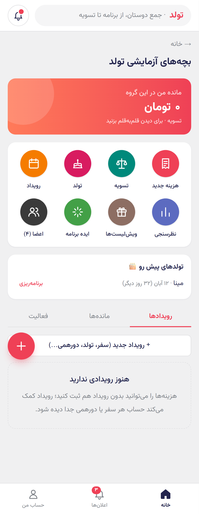
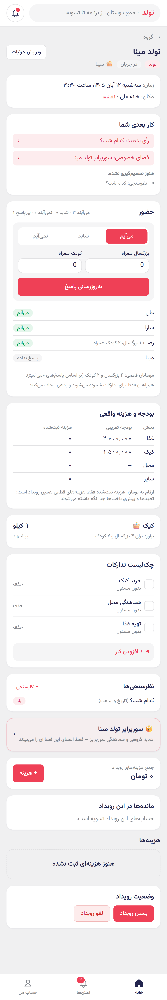
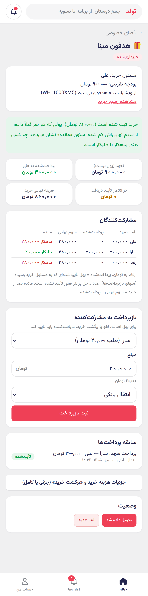
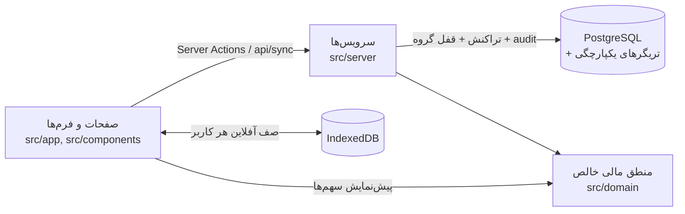

# تولد (tavalod) — پروژه آموزشی

[](https://github.com/takner/tavalod-course/actions/workflows/ci.yml)
[](LICENSE)

> **English summary:** A Persian (RTL), mobile-first PWA for groups of friends to plan birthdays, trips and gatherings — and to split, explain and settle the money. Built with Next.js 16, TypeScript, PostgreSQL and Drizzle, with exact `bigint` money, property-based tests, database integrity triggers, an offline queue, private "surprise" spaces and a production Docker deployment. This repository is published as teaching material; its history is organised as learning steps.

«تولد» اپی برای هماهنگی جمع دوستان است: **از برنامه‌ریزی تا تسویه**. یک جمع می‌تواند هزینه‌های سفر و دورهمی را ثبت کند، سهم هر نفر را دقیق ببیند و تسویه کند؛ و یک تولد را از ویش‌لیست و نظرسنجی زمان تا هدیه گروهی سورپرایز مدیریت کند.

این مخزن برای آموزش منتشر شده است: کد واقعی یک محصول کوچک اما کامل، با تست، استقرار و تصمیم‌های طراحی مستند.

<p align="center">
  
  
  
</p>

## اصل محصول
**حساب‌ها همیشه درست بمانند و هر عددی که نشان داده می‌شود قابل توضیح باشد.** به همین خاطر:

- پول همیشه عدد صحیح تومان است (`bigint` در TypeScript، `int8` در PostgreSQL، رشته در JSON). هیچ‌جا اعشار.
- همه محاسبات مالی در `src/domain/` هستند: توابع خالص، بدون دیتابیس، با تست‌های property-based.
- مانده‌ها ذخیره نمی‌شوند؛ همیشه از هزینه‌ها و تسویه‌ها **مشتق** می‌شوند.
- تریگرهای دیتابیس اجازه commit حالت نامتوازن را نمی‌دهند، حتی اگر کدی اشتباه کند.

## قابلیت‌ها
**مرحله ۱ — هسته مالی:** گروه و دعوت، عضو مهمان و اتصال آن با لینک یک‌بارمصرف، رویداد، هزینه با چهار نوع تقسیم (مساوی، مبلغ، درصد، وزنی) و چند پرداخت‌کننده، برگشت خرید، مانده با توضیح قلم‌به‌قلم، «پیشنهاد تسویه با انتقال کمتر»، تسویه با تأیید دریافت‌کننده، سابقه تغییرات، ثبت آفلاین با جلوگیری از ثبت تکراری، ورود با لینک ایمیلی.

**مرحله ۲ — تولد و دورهمی:** ویش‌لیست با سطح نمایش و رزرو پنهان از صاحب آن، فضای خصوصی سورپرایز (صاحب تولد از هیچ مسیری چیزی نمی‌بیند)، هدیه گروهی با تعهد/پیش‌پرداخت/خرید جدا، نظرسنجی، حضور و همراهان، بودجه، چک‌لیست، محاسبه کیک، یادآوری داخل اپ.

## فناوری‌ها
Next.js 16 (App Router، Server Actions) · TypeScript · PostgreSQL 16 · Drizzle ORM · Tailwind CSS 4 · Zod · Vitest + fast-check · Playwright · Docker Compose + Traefik

## معماری در یک نگاه


| مسیر | محتوا |
|---|---|
| `src/domain` | تقسیم، مانده، تسویه، تخصیص، برگشت، هدیه، نظرسنجی، کیک، تقویم — خالص و تست‌شده |
| `src/server` | سرویس‌ها: مجوزها، تراکنش‌ها، idempotency، audit، اعلان، احراز هویت |
| `src/db` + `drizzle/` | schema و migrationها (شامل تریگرهای یکپارچگی) |
| `src/app` | صفحات، Server Actionها، `api/sync`، `api/health` |
| `tests/integration` | تست روی PostgreSQL واقعی (سناریوهای پذیرش، نشت اطلاعات، هم‌زمانی، migration) |
| `e2e/` | Playwright روی ویوپورت موبایل (شامل سناریوی کامل تولد چهارنفره) |
| `deploy/` | Dockerfile، Compose، استقرار، بکاپ، rollback |
| `docs/` | راهنمای عملیات، برنامه مرحله ۲ با مثال عددی، [مسیر یادگیری](docs/learning-guide.md) |

## اجرای محلی
پیش‌نیاز: Node.js 24 و Docker.

```bash
npm ci
cp .env.example .env.local       # EMAIL_TRANSPORT=console: لینک ورود در ترمینال چاپ می‌شود
npm run db:up                    # PostgreSQL روی 127.0.0.1:5433
npm run db:migrate
npm run dev                      # http://localhost:3000
```

برای ورود، ایمیل دلخواهی وارد کنید و لینک چاپ‌شده در ترمینال را باز کنید.

## تست‌ها
```bash
npm run typecheck && npm run lint
npm test          # واحد + یکپارچه (دیتابیس tavalod_test پاک و از نو ساخته می‌شود)
npm run e2e       # Playwright (دیتابیس tavalod_e2e)
```

## مسیر یادگیری
تاریخچه Git این مخزن مرحله‌به‌مرحله ساخته شده و هر مرحله یک تگ دارد (`step-01-domain` تا `step-07-public`). راهنمای قدم‌به‌قدم، نکات کلیدی هر مرحله و تمرین‌ها در [docs/learning-guide.md](docs/learning-guide.md) است.

```bash
git checkout step-01-domain   # شروع از هسته مالی
git checkout main             # بازگشت به آخرین نسخه
```

## استقرار روی سرور خودتان
راهنمای کامل: [docs/operations.md](docs/operations.md). خلاصه: `deploy/deploy.env.example` را به `deploy/deploy.env` کپی و مقادیر سرور خودتان را وارد کنید، سپس `deploy/deploy.sh init` و `deploy/deploy.sh`.

## درباره استفاده از هوش مصنوعی
این پروژه با کمک Claude Code ساخته شده و commitها این را با `Co-Authored-By` نشان می‌دهند. فایل [`CLAUDE.md`](CLAUDE.md) قواعدی است که دستیار هوش مصنوعی هنگام کار روی کد رعایت می‌کند؛ خواندن آن برای دیدن اینکه چطور می‌شود قواعد پروژه را برای انسان و ماشین صریح نوشت، مفید است.

## مشارکت و امنیت
راهنمای مشارکت: [CONTRIBUTING.md](CONTRIBUTING.md) · گزارش آسیب‌پذیری: [SECURITY.md](SECURITY.md) · آیین رفتاری: [CODE_OF_CONDUCT.md](CODE_OF_CONDUCT.md)

## مجوز
کد تحت مجوز [MIT](LICENSE). فونت وزیرمتن تحت SIL Open Font License (`src/fonts/LICENSE-Vazirmatn`).
